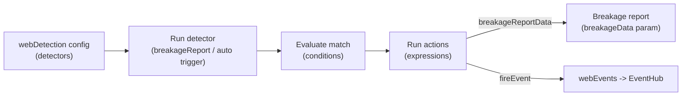

# Web Detection Framework

The **web detection framework** (`webDetection` C-S-S feature) is a config-driven system for detecting page content patterns (e.g., adwalls, CAPTCHAs, breakage indicators). Detectors are defined entirely in remote config, so new patterns don't need code changes. Each detector defines *when* to run (`triggers`), an optional condition for *when it has detected* (`match`), and *what each run does* (`actions`): with `match`, the actions run once, on the run where it holds; without it, on every run.

A detector's results go to one or both of two places. The `breakageReportData` action writes its entry, with any values its payload names, to breakage reports. The `fireEvent` action emits a `webEvent`, with an optional payload, consumed by the [EventHub](https://github.com/duckduckgo/ddg-workflow/blob/main/docs/event-hub/README.md), where it can be consumed for use in additional pixels.

> This is distinct from the on-demand `webInterferenceDetection` utilities; see the [overview](overview.md).

## End-to-end flow

## Documents

| Document | Purpose |
|---|---|
| [overview.md](overview.md) | Start here. How a detector runs, its config and defaults, triggers (`breakageReport`, `auto`), `match` and when a detector is done, actions (`fireEvent`, `breakageReportData`, `define`), and where results go. |
| [authoring/](authoring/README.md) | Writing a new detector or changing an existing one: the sequence from config change to verified rollout, the decisions inside it, and when a change needs a privacy triage. |
| [conditions.md](conditions.md) | The `text` and `element` conditions in full: operators, every key, and what each costs on the page. |
| [expressions.md](expressions.md) | Values, positions, operators, modifiers, `is`, `if`, sequences, names, evaluation order. |
| [sources.md](sources.md) | The sources `element`, `text` and `api`, `where` and `field` on items, XPath, arguments and JS builtins, the performance timeline, and `root`. |
| [predicates.md](predicates.md) | The predicate shape `is` and `where` share: forms, keys and the long form, failure and type, property reads. |
| [payloads.md](payloads.md) | What `fireEvent` and `breakageReportData` send: the payload spec, `when`, buckets, and how events become EventHub pixels. |
| [failures.md](failures.md) | Failures, errors, parse errors and run errors: what each does to a run, how it is reported, and how to handle it. |
| [validation.md](validation.md) | Parse errors on device, and the checks CI runs on every detector, the `api` allowlist included. |
| [recipes.md](recipes.md) | Configs for common measurements: counts, ratios, rendered text, load state, computed style, the performance timeline, missing fields and throwing reads, JS builtins, detector shapes. |
| [breakageData-parameter.md](breakageData-parameter.md) | Format for conveying detection results in breakage reports (`breakageData` parameter): per-detector entries, their `data` and recorded `errors`. |
| [versions.md](versions.md) | Which C-S-S release each capability arrived in, and the earliest app version of each platform carrying it, for version gates. |

## Sources of truth

| For | Source |
|---|---|
| What config means and what a detector does | These docs |
| Implementation detail | C-S-S [`injected/src/features/web-detection/`](https://github.com/duckduckgo/content-scope-scripts/tree/main/injected/src/features/web-detection/) and [`web-detection.js`](https://github.com/duckduckgo/content-scope-scripts/blob/main/injected/src/features/web-detection.js) beside it |
| Config schema | [`schema/features/web-detection.ts`](../../schema/features/web-detection.ts) |
| `webEvents` schema, used by `fireEvent` | [`schema/features/web-events.ts`](../../schema/features/web-events.ts) |
| Shipped detectors | [`features/web-detection.json`](../../features/web-detection.json) |

Where C-S-S and these docs differ on what config means, the docs state the intended behaviour.
