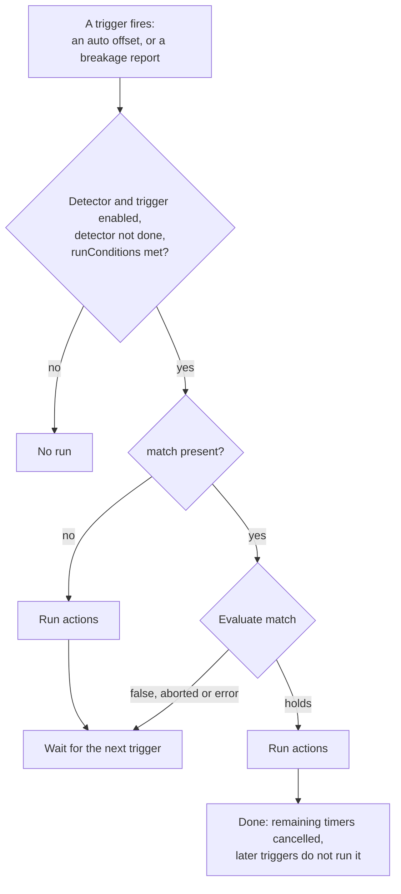
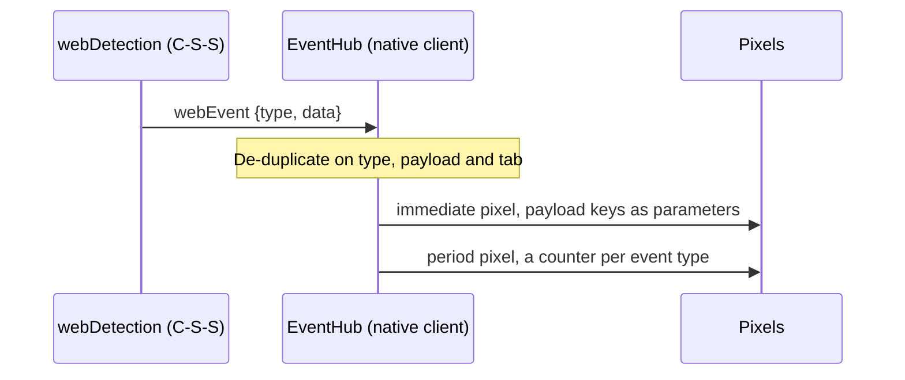

# Web Detection Overview

A web detector looks for a pattern on a page, such as an adwall, a CAPTCHA or a sign of breakage, and reports what it finds. Detectors are defined in the remote config of the `webDetection` C-S-S feature, so adding or changing one needs no client release.

A detector names *when* it runs (`triggers`), an optional condition for when it has detected (`match`), and *what each run does* (`actions`). Its results go to breakage reports through the `breakageReportData` action, and to the [EventHub](https://github.com/duckduckgo/ddg-workflow/blob/main/docs/event-hub/core-design.md) through the `fireEvent` action, where telemetry config can turn them into pixels.

> This framework is distinct from the on-demand `webInterferenceDetection` utilities, which other features invoke directly; see the [C-S-S detectors README](https://github.com/duckduckgo/content-scope-scripts/blob/main/injected/src/detectors/README.md).

## How a detector runs

In each frame, every trigger runs the detector as follows ([`match`](#match) has the effect of each result):



## Configuration

Detectors are configured under `webDetection.settings.detectors`, in named groups. Keys in `[brackets]` are optional:

```json
"webDetection": {
  "settings": {
    "detectors": {
      "<group_name>": {
        "<detector_id>": {
          ["state"]: "<enabled|disabled>",
          ["triggers"]: {
            ["breakageReport"]: {["state"]: "<enabled|disabled>", ["runConditions"]: <COND>},
            ["auto"]: {["state"]: "<enabled|disabled>", ["runConditions"]: <COND>, "when": {"intervalMs": [<int>]}}
          },
          ["match"]: <EXPR>,
          "actions": <EXPR> | [<EXPR>, ...]
        }
      }
    }
  }
}
```

- `detectors` contains detector *groups*
- each *group* maps detector names to their configs, and namespaces them
  - Detector names and group names must wholly match the regex `^[a-zA-Z][a-zA-Z0-9_]*$`. CI refuses a name that doesn't, since C-S-S uses each name as config gives it
- each detector has four parts:
  - `state` - a `disabled` detector does not run
  - `triggers` - *when* the detector runs ([Triggers](#triggers))
  - `match` - optional. The condition for the detector having *detected*, after which it's done ([`match`](#match))
  - `actions` - what each run does: an expression, or a sequence of them ([Actions](#actions))

### Example

```json
"detectors": {
  "adwallDetectors": {
    "genericAdblockMessage": {
      "match": {
        "text": {"pattern": "adblocker detected"}
      },
      "triggers": {
        "auto": {"state": "enabled", "when": {"intervalMs": [1000, 5000]}}
      },
      "actions": {"fireEvent": {"type": "<event type>"}, "breakageReportData": {}}
    }
  },
  "breakageInfoDetectors": {
    // using the trigger defaults, this runs when a breakage report is filed
    "videoPlayerUnavailable": {
      "match": {
        "text": {
          "pattern": "video unavailable",
          "selector": [".video-player", ".video-overlay"]
        }
      },
      "actions": {"breakageReportData": {}}
    }
  }
}
```

### Defaults

When fields are omitted from config, detectors take these defaults:

```json
{
  "state": "enabled",
  "triggers": {
    "breakageReport": { "state": "enabled", "runConditions": {"context": {"top": true}} },
    "auto": { "state": "disabled", "runConditions": {"context": {"top": true}}, "when": {"intervalMs": []} }
  }
}
```

`actions` has no default, and a detector without it does not parse ([Validation](validation.md#detectors-and-actions)).

So by default a new detector:

- is enabled
- runs only when building data for the breakage report (the `auto` trigger is opt-in)
- runs only in the top frame
- writes a breakage report entry only through a `breakageReportData` action, and fires events only through a `fireEvent` action

## Triggers

| Trigger | Runs the detector | Default |
|---|---|---|
| `breakageReport` | During the breakage report flow, before the report is submitted | Enabled |
| `auto` | On page load, at each offset in `when.intervalMs` | Disabled |

Every trigger takes `state` and `runConditions`. A `disabled` trigger doesn't run the detector, whatever its other keys.

### `auto`

`when.intervalMs` is a set of delays in milliseconds, measured from when the feature initialises in the frame, and the detector runs at each one. A timer can fire late, so a run happens at or after its offset. A detector that is [done](#match) runs at no later offset. [Tuning `auto` intervals](authoring/writing-detectors.md#tuning-auto-intervals) covers choosing them.

Here the detector runs on every site when a breakage report is filed, but runs automatically only on `.fr` sites, 100ms, 500ms and 1s after load:

```json
"frenchAdblockMessage": {
  "match": {"text": {"pattern": ["bloc publicitaire détecté"]}},
  "triggers": {
    "breakageReport": {"state": "enabled"},
    "auto": {
      "state": "enabled",
      "runConditions": {"context": {"top": true}, "urlPattern": "https://*.fr/*"},
      "when": {"intervalMs": [100, 500, 1000]}
    }
  },
  "actions": {"breakageReportData": {}}
}
```

### runConditions

`runConditions` narrows when a triggered detector runs, e.g., only on sites matching a given pattern. It uses the same conditions as [ConditionalChanges](https://github.com/duckduckgo/content-scope-scripts/blob/main/injected/docs/coding-guidelines.md#conditional-changes). Translations and other per-site changes go in `runConditions`, or in `conditionalChanges` where more flexibility is needed.

Each trigger's `runConditions` defaults to the top frame only:

```json
"runConditions": {
  "context": {"top": true}
}
```

A `runConditions` value replaces this default rather than merging with it, so a detector runs in iframes by setting it to `{}`.

## `match`

Each run evaluates `match` first. `match` is an expression in boolean position ([Positions](expressions.md#positions)). Its leaves are the `text` and `element` conditions ([Conditions](conditions.md)) and the values and tests in [Expressions](expressions.md), combined by `any`, `all` and `none`.

| `match` | Effect on the run | The detector |
|---|---|---|
| Holds | `actions` runs once | Done when the run ends, whether `actions` ran to its end or failed |
| Does not hold, aborts or errors | `actions` does not run. A failure is recorded ([Failures](failures.md)) | Runs again on its next trigger |
| Absent | `actions` runs | Runs again on its next trigger, and is never done |

A done detector runs no more in that frame, whatever the trigger: its timers are cancelled, and a breakage report does not run it. Each frame's detector is done on its own. Its breakage entry keeps what its runs wrote.

`match` reads the page only: it holds no action and no `ref`. A detector with `match` uses no detector names, since its `actions` runs once ([Validation](validation.md#detectors)). `actions` reads again any value `match` tested that its payloads send.

| Use | Config |
|---|---|
| Detect once | `"match": D`, and `actions` holding the detection's `fireEvent` and `breakageReportData` |
| Detect once, once a precondition `P` holds | `"match": {"all": [P, D]}`, or `{"if": P, "then": D, "else": false}` where `D` fails before `P` holds |
| Measure on every run | No `match`. A `breakageReportData` on every run, and each event inside a [once guard](recipes.md#doing-something-once) |

In a detector with no `match`, a `fireEvent` outside a once guard sends its event on every run. Weak and strong signals, finishing early and other shapes are in [Detector shapes](recipes.md#detector-shapes).

## Actions

`actions` is an expression, or an array of them run in order ([Sequences](expressions.md#sequences)). Actions are expressions with an effect: `fireEvent` sends an event, `breakageReportData` writes the detector's breakage-report entry, and `define` binds names that later expressions read.

```json
"<detector>": {
  "triggers": {"auto": {"state": "enabled", "when": {"intervalMs": [1000, 5000]}}},
  "match": {"text": {"pattern": "ad ?block(er)? detected"}},
  "actions": {"fireEvent": {"type": "<event type>"}, "breakageReportData": {}}
}
```

### Action keys

| Key | Value | Effect |
|---|---|---|
| `fireEvent` | `{"type": <string>, "data"?: <payload spec>}` | Sends a `webEvent` of that type, with the payload ([EventHub](#eventhub)) |
| `breakageReportData` | `{}`, or `{"data": <payload spec>}` | Writes the detector's entry in breakage reports ([Breakage reports](#breakage-reports)) |
| `define` | `{<name>: <expression>}` | Binds each name to its expression's value ([Names](expressions.md#names)) |

An action gives `undefined`. An action computes every value its payload names, then sends or writes. An action whose payload fails sends and writes nothing, and the failure propagates as any failure does ([Failures](failures.md)).

An object holds expression keys with their modifiers, or action keys, never both. Action keys in one object run in the order the config lists them, so `{"fireEvent": A, "breakageReportData": B}` is `[{"fireEvent": A}, {"breakageReportData": B}]`. Note that on Apple, an object with only `fireEvent` and `breakageReportData` stays one object, so those two run in no guaranteed order.

`define` binds a run name (`"x"`), which lasts for the rest of the run, or a detector name (`"this.x"`), which lasts across every run and trigger in the frame. `{"ref": "x"}` reads it. A detector name keeps state between runs, such as a count of reads, the previous read or a flag that an action has run ([Names](expressions.md#names)).

## Results

### Breakage reports

A `breakageReportData` action writes the detector's entry in the `breakageData` parameter of breakage reports, with any values its payload names. The entry also records the detector's failures. The format is in [`breakageData` parameter](breakageData-parameter.md#webdetection).

### EventHub

A `fireEvent` action sends a `webEvent`, `{type, data}`, from C-S-S to the native client, where EventHub handles it:



EventHub de-duplicates events on type, payload and tab ([De-duplication](https://github.com/duckduckgo/ddg-workflow/blob/main/docs/event-hub/deduplication.md)), and its telemetry config turns them into pixels ([Telemetry handler](https://github.com/duckduckgo/ddg-workflow/blob/main/docs/event-hub/handlers/telemetry.md)). A detector's event type needs a consumer in that config ([Shipping a detector](authoring/shipping-a-detector.md)).

### Payloads

Both actions take an optional `data` map of the values to send. Each field's `value` is an expression computed when the action runs, or a name bound with `define`. An optional `when` tests the value before it's sent, and `buckets` send a bucket name in place of the value. CI requires `buckets` on every `fireEvent` field, and they're optional in `breakageReportData`:

```json
"fireEvent": {"type": "brokenImages", "data": {"brokenImages": {"value": {"ref": "brokenImages"}, "buckets": [{"name": "one", "is": 1}, {"name": "2-4", "is": {"gte": 2, "lt": 5}}, {"name": "5+", "is": {"gte": 5}}]}}}
```

With 3 broken images, this sends `{"type": "brokenImages", "data": {"brokenImages": "2-4"}}`. [Payloads](payloads.md) has the full rules, and how to shape events for period pixels.
