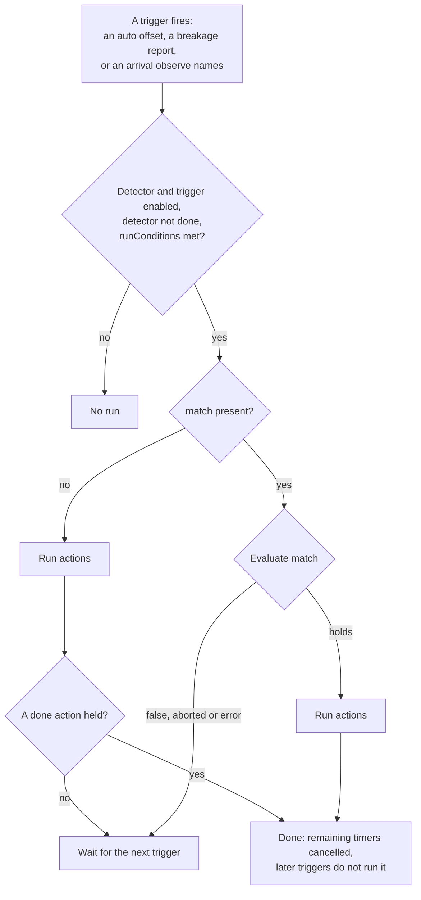
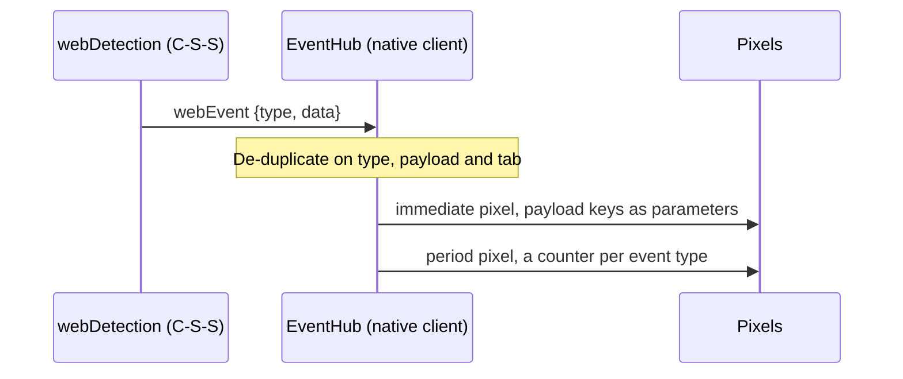

# Web Detection Overview

A web detector looks for a pattern on a page, such as an adwall, a CAPTCHA or a sign of breakage, and reports what it finds. Detectors are defined in the remote config of the `webDetection` C-S-S feature, so adding or changing one doesn't need a client release.

A detector says *when* it runs (`triggers`), optionally when it has detected something (`match`), and *what each run does* (`actions`). Its results go to breakage reports through the `breakageReportData` action, and to the [EventHub](https://github.com/duckduckgo/ddg-workflow/blob/main/docs/event-hub/core-design.md) through the `fireEvent` action, where telemetry config can turn them into pixels.

> This framework is distinct from the on-demand `webInterferenceDetection` utilities, which other features call directly (see the [C-S-S detectors README](https://github.com/duckduckgo/content-scope-scripts/blob/main/injected/src/detectors/README.md)).

## How a detector runs

In each frame, each trigger runs the detector like this (see [`match`](#match) for what each result means):



## Configuration

Detectors are configured under `webDetection.settings.detectors`, in named groups. Keys in `[brackets]` are optional:

```json
"webDetection": {
  "settings": {
    "detectors": {
      "<group_name>": {
        "<detector_id>": {
          ["state"]: "<enabled|disabled>",
          ["triggers"]: {
            ["breakageReport"]: {["state"]: "<enabled|disabled>", ["runConditions"]: <COND>},
            ["auto"]: {["state"]: "<enabled|disabled>", ["runConditions"]: <COND>, "when": {"intervalMs": [<int>]}},
            ["observe"]: {["state"]: "<enabled|disabled>", ["runConditions"]: <COND>, "on": [<ON BODY>, ...]}
          },
          ["match"]: <EXPR>,
          "actions": <EXPR> | [<EXPR>, ...]
        }
      }
    },
    ["readCacheMaxAgeMs"]: <int> | null
  }
}
```

- `detectors` contains detector *groups*
- each *group* maps detector names to their configs, and namespaces them
  - Detector and group names must fully match the regex `^[a-zA-Z][a-zA-Z0-9_]*$`. CI rejects any name that doesn't, because C-S-S uses each name exactly as it appears in config
- each detector has four parts:
  - `state` - a `disabled` detector doesn't run
  - `triggers` - *when* the detector runs ([Triggers](#triggers))
  - `match` - optional. The condition for the detector having *detected*, after which it's done ([`match`](#match)). A detector without it can end with a [`done`](#done) action
  - `actions` - what each run does: an expression, or a sequence of them ([Actions](#actions))

### Example

```json
"detectors": {
  "adwallDetectors": {
    "genericAdblockMessage": {
      "match": {
        "text": {"pattern": "adblocker detected"}
      },
      "triggers": {
        "auto": {"state": "enabled", "when": {"intervalMs": [1000, 5000]}}
      },
      "actions": {"fireEvent": {"type": "<event type>"}, "breakageReportData": {}}
    }
  },
  "breakageInfoDetectors": {
    // using the trigger defaults, this runs when a breakage report is filed
    "videoPlayerUnavailable": {
      "match": {
        "text": {
          "pattern": "video unavailable",
          "selector": [".video-player", ".video-overlay"]
        }
      },
      "actions": {"breakageReportData": {}}
    }
  }
}
```

### Defaults

When fields are omitted from config, detectors take these defaults:

```json
{
  "state": "enabled",
  "triggers": {
    "breakageReport": { "state": "enabled", "runConditions": {"context": {"top": true}} },
    "auto": { "state": "disabled", "runConditions": {"context": {"top": true}}, "when": {"intervalMs": []} },
    "observe": { "state": "disabled", "runConditions": {"context": {"top": true}} }
  }
}
```

The config build writes `"keep": {"count": 10, "withinMs": 5000}` onto every [`observed`](sources.md#observed) body without `keep`, and `"timeoutMs": 5000` onto every [`wait`](sources.md#wait) without `timeoutMs`.

`actions` has no default, and a detector without it doesn't parse ([Validation](validation.md#detectors-and-actions)).

So by default a new detector:

- is enabled
- runs only when building data for the breakage report (the `auto` trigger is opt-in)
- runs only in the top frame
- writes a breakage report entry only through a `breakageReportData` action, and fires events only through a `fireEvent` action

### Feature settings

These sit beside `detectors` in `webDetection.settings`, and apply to every detector in the frame:

| Setting | Meaning | Absent |
|---|---|---|
| `readCacheMaxAgeMs` | How long the XPath selections and element text the detectors read are kept for later runs while the page is unchanged: `null` until the page changes, a number of ms up to 600000, or `0` for the detectors that run at the same time only. The first change to the DOM under a node that was read clears them | The config build writes `null` |

## Triggers

| Trigger | Runs the detector | Default |
|---|---|---|
| `breakageReport` | During the breakage report flow, before the report is submitted | Enabled |
| `auto` | On page load, at each offset in `when.intervalMs` | Disabled |
| `observe` | When a performance entry or an event of a type in `on` is recorded, the page hiding included | Disabled |

Every trigger takes `state` and `runConditions`. A `disabled` trigger doesn't run the detector, whatever its other keys say.

### `auto`

`when.intervalMs` is a set of delays in milliseconds, measured from when the feature initialises in the frame, and the detector runs at each one. Timers can fire late, so each run happens at or after its offset. Once a detector is [done](#match), it doesn't run at any later offset. See [Tuning `auto` intervals](authoring/writing-detectors.md#tuning-auto-intervals) for how to choose them.

Here the detector runs on every site when a breakage report is filed, but runs automatically only on `.fr` sites, 100ms, 500ms and 1s after load:

```json
"frenchAdblockMessage": {
  "match": {"text": {"pattern": ["bloc publicitaire détecté"]}},
  "triggers": {
    "breakageReport": {"state": "enabled"},
    "auto": {
      "state": "enabled",
      "runConditions": {"context": {"top": true}, "urlPattern": "https://*.fr/*"},
      "when": {"intervalMs": [100, 500, 1000]}
    }
  },
  "actions": {"breakageReportData": {}}
}
```

### `observe`

`on` lists the types whose arrival runs the detector. Each body names a type as an [`observed`](sources.md#observed) body does:

```json
"triggers": {
  "observe": {"state": "enabled", "on": [
    {"entryType": "long-animation-frame", "delayMs": 1000},
    {"event": "click", "sync": true, "whenBusy": "skip"},
    {"event": "visibilitychange", "sync": true, "whenBusy": "interrupt"},
    {"event": "pagehide", "sync": true, "whenBusy": "interrupt"}
  ]}
}
```

| Key | Meaning |
|---|---|
| `entryType`, `durationThreshold`, `event`, `target` | The type, as on `observed` |
| `where` | Optional. A predicate on the item's fields with literal values. It's tested as the item is recorded, outside any run, so it reads no names and no page values |
| `delayMs` | Optional, default 0. The run is in a task `delayMs` after the arrival |
| `sync` | Optional, default `false`. The run is in the listener, during dispatch, before the page's own listeners further along the event's path. Required on `visibilitychange` and `pagehide`, allowed on `click`, and not with `delayMs` |
| `whenPending` | Optional, default `"run"`. What the arrival does while a run of the detector is pending ([Pending runs](#pending-runs)). Not with `sync` |
| `whenBusy` | Optional, default `"queue"`. What the arrival does while a run of the detector is suspended in a [`wait`](sources.md#wait): `"queue"` runs it after the suspended run ends, `"interrupt"` abandons the suspended run and runs now, and `"skip"` runs nothing. A `sync` body has `"interrupt"` or `"skip"`, since a queued run happens after dispatch, and only `sync` bodies take `"interrupt"` |

Each arrival runs the detector once if its body gives an item from it, unless a run of the detector is pending. A batch of entries delivered together is one arrival, which runs the detector once if any entry passes the body's `durationThreshold` and `where`. The run reads the arrival through [`trigger`](sources.md#trigger), and earlier items through `observed`, so each body names a type a source in the detector reads ([Recorded types](validation.md#recorded-types-wait-and-observe)). Detectors due at the same time run in one task.

A `sync` run adds its cost to the event's dispatch, up to its first `wait`, so a `sync` `click` body delays the page's own response to the click. A `wait` in a `sync` run starts during dispatch, so a `mutation` wait sees the changes the page's own listeners make for the event.

An arrival whose body gives no item doesn't queue behind or interrupt a suspended run.

#### Pending runs

A run is pending from when an arrival schedules it with `delayMs` until it's due. An arrival acts on the detector's latest pending run, whichever body scheduled it, as its body's `whenPending` sets:

| `whenPending` | The arrival | What the run's `trigger` gives |
|---|---|---|
| `"run"` | Schedules its own run | Its own arrival |
| `"skip"` | Schedules nothing | The pending run's arrival. `observed` reads the skipped one |
| `"batch"` | Adds its items to the pending run, and schedules nothing | The items of every arrival batched into it, in the order they arrived |
| `"replace"` | Cancels the pending run, and schedules its own | Its own arrival. `observed` reads the replaced one |

With `"skip"` and `"batch"`, the detector runs `delayMs` after the first arrival, so it runs at most once per `delayMs` while arrivals keep coming. With `"replace"`, it runs `delayMs` after the last, once they stop:

```jsonc
// At most one run per 250 ms while anything scrolls, after the first scroll of each window
{"event": "scroll", "delayMs": 250, "whenPending": "skip"}
// One run 1 s after the first batch of frames, reading every batch since
{"entryType": "long-animation-frame", "delayMs": 1000, "whenPending": "batch"}
// One run 3 s after the last of several route changes
{"event": "navigatesuccess", "target": {"api": "navigation"}, "delayMs": 3000, "whenPending": "replace"}
```

`scroll` arrives every frame while the page scrolls, so CI requires `"skip"` or `"batch"` on its bodies ([Recorded types](validation.md#recorded-types-wait-and-observe)).

#### The page hiding

A detector that sends when the page hides observes `visibilitychange` and `pagehide`, each with `"sync": true` and `"whenBusy": "interrupt"`. After `pagehide`, the page's queued tasks may never run, and a hidden page's timers are throttled, so the run happens in the listener. A run queued behind a `wait` would run only when that wait ends, which can be at its `timeoutMs`, so the hide interrupts a suspended run.

A navigation away from a visible page fires `pagehide` and then `visibilitychange`, so the detector runs twice, with `document.hidden` `false` on the first run. A tab or app switch fires `visibilitychange` only. A detector that sends once tests `document.hidden` and a detector name before it sends:

```json
"actions": {
  "if": {"all": [{"api": "document.hidden"}, {"none": [{"ref": "this.sent", "is": true}]}]},
  "then": [{"fireEvent": {"type": "<event type>"}}, {"define": {"this.sent": true}}]
}
```

In a detector with no `match` that observes either event, CI requires each `fireEvent` to be inside an `if` like this one, or in a sequence with `{"done": true}`. A page shown again and hidden again runs the detector again, unless it's done.

### runConditions

`runConditions` narrows when a triggered detector runs, e.g., only on sites matching a given pattern. It uses the same conditions as [ConditionalChanges](https://github.com/duckduckgo/content-scope-scripts/blob/main/injected/docs/coding-guidelines.md#conditional-changes). Translations and other per-site changes go in `runConditions`, or in `conditionalChanges` where more flexibility is needed.

Each trigger's `runConditions` defaults to the top frame only:

```json
"runConditions": {
  "context": {"top": true}
}
```

A `runConditions` value replaces this default instead of merging with it, so setting it to `{}` lets a detector run in iframes too.

## `match`

Each run evaluates `match` first. `match` is an expression that gives a boolean ([Positions](expressions.md#positions)), built from the `text` and `element` conditions ([Conditions](conditions.md)) and the values and tests in [Expressions](expressions.md), combined with `any`, `all` and `none`.

| `match` | Effect on the run | The detector |
|---|---|---|
| Holds | `actions` runs once | Done when the run ends, whether `actions` ran to its end or failed |
| Doesn't hold, aborts or errors | `actions` doesn't run. A failure is recorded ([Failures](failures.md)) | Runs again on its next trigger |
| Absent | `actions` runs | Runs again on its next trigger, until a [`done`](#done) action holds |

Once a detector is done, it doesn't run again in that frame, whatever the trigger: its timers and pending runs are cancelled, and neither an arrival nor a breakage report runs it. Each frame tracks this separately, and the detector's breakage entry keeps whatever its runs wrote.

`match` only reads the page, so it can't contain an action or a `ref`. A detector with `match` doesn't use detector names, since its `actions` only runs once ([Validation](validation.md#detectors)). If a payload sends a value that `match` tested, `actions` reads it again.

| Use | Config |
|---|---|
| Detect once | `"match": D`, with the detection's `fireEvent` and `breakageReportData` in `actions` |
| Detect once, after a precondition `P` holds | `"match": {"all": [P, D]}`, or `{"if": P, "then": D, "else": false}` where `D` fails before `P` holds |
| Measure on every run | No `match`. A `breakageReportData` on every run, and each event inside a [once guard](recipes.md#doing-something-once) |

In a detector with no `match`, a `fireEvent` outside a once guard sends its event on every run. See [Detector shapes](recipes.md#detector-shapes) for weak and strong signals, finishing early and other patterns.

## Actions

`actions` is an expression, or an array of them run in order ([Sequences](expressions.md#sequences)). Actions are expressions with an effect: `fireEvent` sends an event, `breakageReportData` writes the detector's breakage-report entry, `define` binds names that later expressions read, and `done` ends a detector with no `match`.

```json
"<detector>": {
  "triggers": {"auto": {"state": "enabled", "when": {"intervalMs": [1000, 5000]}}},
  "match": {"text": {"pattern": "ad ?block(er)? detected"}},
  "actions": {"fireEvent": {"type": "<event type>"}, "breakageReportData": {}}
}
```

### Action keys

| Key | Value | Effect |
|---|---|---|
| `fireEvent` | `{"type": <string>, "data"?: <payload spec>}` | Sends a `webEvent` of that type, with the payload ([EventHub](#eventhub)) |
| `breakageReportData` | `{}`, or `{"data": <payload spec>}` | Writes the detector's entry in breakage reports ([Breakage reports](#breakage-reports)) |
| `define` | `{<name>: <expression>}` | Binds each name to its expression's value ([Names](expressions.md#names)) |
| `done` | A condition | Makes the detector done at the end of the run, when it holds ([`done`](#done)) |

An action computes every value its payload names, then sends or writes. If any of those values fails, the action sends and writes nothing, and the failure propagates like any other ([Failures](failures.md)). The action's own value is `undefined`.

An object can have expression keys (with their modifiers) or action keys, but not both. Action keys in one object run in the order they're listed in config, so `{"fireEvent": A, "breakageReportData": B}` is `[{"fireEvent": A}, {"breakageReportData": B}]`. Note that on Apple, an object with only `fireEvent` and `breakageReportData` stays one object, so those two run in no guaranteed order.

`define` binds a run name (`"x"`), which lasts for the rest of the run, or a detector name (`"this.x"`), which lasts across every run and trigger in the frame. `{"ref": "x"}` reads it. Detector names are how a detector keeps state between runs, such as a count of reads, the previous read or a flag that an action has run ([Names](expressions.md#names)).

### `done`

`done` ends a detector with no `match`. Its value is in boolean position, and when it holds, the detector is done at the end of the run, the same way it is once `match` holds:

```jsonc
// Done on an engine without long animation frames
{"done": {"none": [{"api": {"path": "PerformanceObserver.supportedEntryTypes.includes", "args": ["long-animation-frame"]}}]}}
// Done once the events are sent
{"done": {"ref": "this.sent"}}
```

- A value that doesn't hold, or `undefined`, leaves the detector as it is. Several `done`s in a run combine by OR.
- A `done` that held stays in effect if the run fails after it.
- In a run suspended at a [`wait`](sources.md#wait), the detector is done when the run ends. A run abandoned by `"whenBusy": "interrupt"` ends there, so a `done` that held before its `wait` makes the detector done, and the interrupting arrival runs nothing.
- CI rejects `done` in `match`, and in a detector with `match`.

A detector with no `match` and no `done` runs on every trigger for the life of the frame, and keeps recording the types it reads.

## Results

### Breakage reports

A `breakageReportData` action writes the detector's entry in the `breakageData` parameter of breakage reports, with any values its payload names. The entry also records the detector's failures. See [`breakageData` parameter](breakageData-parameter.md#webdetection) for the format.

### EventHub

A `fireEvent` action sends a `webEvent`, `{type, data}`, from C-S-S to the native client, where EventHub handles it:



EventHub de-duplicates events on type, payload and tab ([De-duplication](https://github.com/duckduckgo/ddg-workflow/blob/main/docs/event-hub/deduplication.md)), and its telemetry config turns them into pixels ([Telemetry handler](https://github.com/duckduckgo/ddg-workflow/blob/main/docs/event-hub/handlers/telemetry.md)). A detector's event type needs a consumer in that config ([Shipping a detector](authoring/shipping-a-detector.md)).

### Payloads

Both actions take an optional `data` map of the values to send. Each field's `value` is an expression computed when the action runs, or a name bound with `define`. An optional `when` tests the value before it's sent, and `buckets` send a bucket name in place of the value. CI requires `buckets` on every `fireEvent` field, and they're optional in `breakageReportData`:

```json
"fireEvent": {"type": "brokenImages", "data": {"brokenImages": {"value": {"ref": "brokenImages"}, "buckets": [{"name": "one", "is": 1}, {"name": "2-4", "is": {"gte": 2, "lt": 5}}, {"name": "5+", "is": {"gte": 5}}]}}}
```

With 3 broken images, this sends `{"type": "brokenImages", "data": {"brokenImages": "2-4"}}`. See [Payloads](payloads.md) for the full rules and how to shape events for period pixels.
