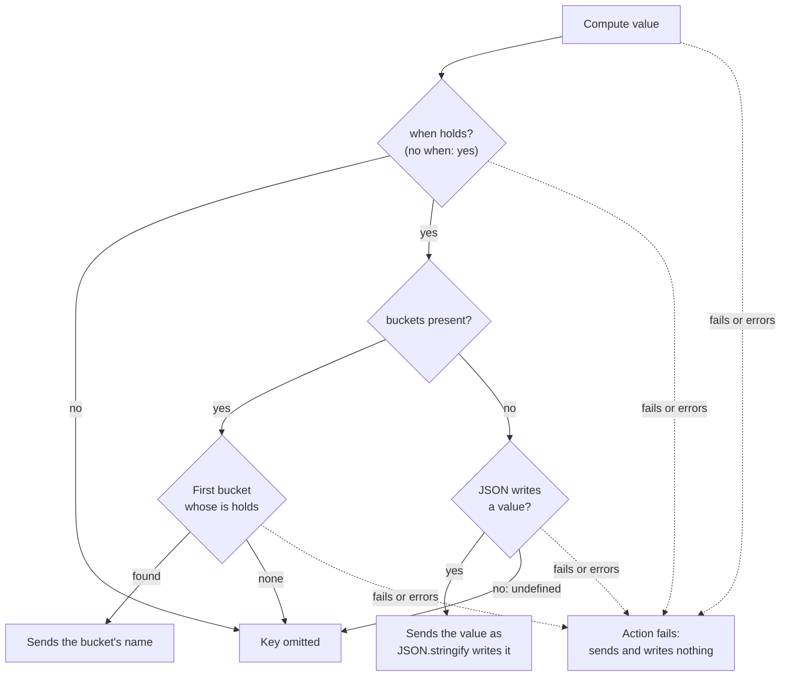

# Payloads

The `fireEvent` and `breakageReportData` [actions](overview.md#actions) take an optional `data` map naming values to send when the action runs.

## Payload spec

```ts
type Bucket = { name: string; is: Predicate };
type PayloadField = { value: Expr; when?: Predicate; buckets?: Bucket[] };
type PayloadSpec = Record<string, PayloadField>;
```

| Part | Rule |
|---|---|
| Key | The payload key on the wire. Matches `^[a-zA-Z][a-zA-Z0-9_]*$`, and is never `nativeData`. CI checks both ([Payloads](validation.md#payloads)) |
| `value` | An expression in value position ([Positions](expressions.md#positions)). `{"ref": "<name>"}` reports a value bound with `define` ([Names](expressions.md#names)); anything else is computed where the action runs. Each bucket tests a selected list as [Selected lists](expressions.md#selected-lists) says |
| `when` | Optional. A [predicate](predicates.md) the value passes to be sent ([`when`](#when)) |
| `buckets` | Required in `fireEvent` by CI ([Payloads](validation.md#payloads)), and optional in `breakageReportData`. See [Buckets](#buckets) |

Each field is sent as follows:



Unbucketed, a selected list is sent as the array of its items, `NaN` and the infinities as `null`, and an object or node as JSON writes it. `undefined` comes from an `if` with no branch taken or an unbound name.

`when` with `type`, or `Number.isFinite` called on the value ([Calls](predicates.md#calls)), states which values are sent.

CI requires `buckets` on every `fireEvent` field, so an event sends a bucket name for each key. Each distinct payload is its own EventHub event: de-duplication separates them, and each is its own immediate pixel.

A failed value reaches `when` and the buckets, where `fails` handles it ([Handling](failures.md#handling)).

## `when`

A payload field's `when` is a [predicate](predicates.md) on the field's value. It tests the value before it is sent or bucketed. Here a `breakageReportData` field writes the navigation type on a navigation or a reload, and omits it otherwise. The value is written unbucketed, and `only` writes the list's one item:

```json
"data": {"navigationType": {"value": {"only": {"api": {"path": "performance.getEntriesByType", "args": ["navigation"], "field": "type"}}}, "when": {"in": ["navigate", "reload"]}}}
```

## Buckets

`buckets` is an array of buckets, each a `name` and a [predicate](predicates.md) `is`. A value is in a bucket when its `is` holds for it. Ranges take the shape of EventHub counter buckets. A detector bucketing a measurement on every page is in [A measurement on every page](recipes.md#a-measurement-on-every-page).

```json
"buckets": [{"name": "0-3s", "is": {"gte": 0, "lt": 3000}}, {"name": "3-8s", "is": {"gte": 3000, "lt": 8000}}, {"name": "8s+", "is": {"gte": 8000}}]
"buckets": [{"name": "none", "is": 0}, {"name": "one", "is": 1}, {"name": "2-4", "is": {"gte": 2, "lt": 5}}, {"name": "5+", "is": {"gte": 5}}]
"buckets": [{"name": "empty", "is": {"length": 0}}, {"name": "short", "is": {"length": {"gte": 1, "lt": 100}}}, {"name": "long", "is": {"length": {"gte": 100}}}]
"buckets": [{"name": "unsupported", "is": "unsupported"}, {"name": "none", "is": 0}, {"name": "one", "is": 1}, {"name": "2+", "is": {"gte": 2}}]
```

The last buckets a count that reads `"unsupported"` on engines without the field it counts ([Presence](predicates.md#presence)). A comparison on a string that is not numeric is `false`, so `"unsupported"` is in its own bucket alone.

| Part | Rule |
|---|---|
| `buckets` | A non-empty array of objects, each holding `name` and `is` and no other key ([Buckets](validation.md#buckets)) |
| `name` | Any non-empty string. Sent on the wire as written. Several buckets may share a name |
| `is` | Any predicate. It tests the value as an expression's [`is`](expressions.md#is) does |

Buckets are tested in array order, and the first whose `is` holds names the value. A value in no bucket omits its key. CI's checks on overlapping buckets are in [Buckets](validation.md#buckets).

## `fireEvent` and the EventHub bridge

```json
"fireEvent": {"type": "brokenImages", "data": {"brokenImages": {"value": {"ref": "brokenImages"}, "buckets": [{"name": "one", "is": 1}, {"name": "2-4", "is": {"gte": 2, "lt": 5}}, {"name": "5+", "is": {"gte": 5}}]}}}
```

sends:

```json
{"type": "brokenImages", "data": {"brokenImages": "2-4"}}
```

In a `breakageReportData` payload, the same field without `buckets` writes `3`.

`fireEvent` sends a `webEvent` notification, `{type, data}`, from C-S-S to the native client, where EventHub handles it ([EventHub](overview.md#eventhub)). EventHub de-duplicates on type, payload and tab ([De-duplication](https://github.com/duckduckgo/ddg-workflow/blob/main/docs/event-hub/deduplication.md)), so two frames reporting different buckets on one page deliver twice. Triggers default to the top frame.

An `immediate` telemetry trigger reads payload keys as pixel parameters ([Telemetry handler](https://github.com/duckduckgo/ddg-workflow/blob/main/docs/event-hub/handlers/telemetry.md)):

```json
"webTelemetry_brokenImages_immediate": {
  "state": "enabled",
  "trigger": {"type": "immediate", "source": "brokenImages"},
  "parameters": {
    "brokenImages": {"template": "data", "dataKey": "brokenImages"}
  }
}
```

A `period` counter on the same `type` counts the pages it fired on. The full telemetry-side handling (aggregation, bucketing, pixel firing) is specified in the [EventHub telemetry handler](https://github.com/duckduckgo/ddg-workflow/blob/main/docs/event-hub/handlers/telemetry.md).

### Per-bucket events

A `period` pixel counts events by type, and a `data` parameter on it has the last payload value of the period. A distribution over a period takes one event type per bucket: a [chain](expressions.md#sequences) of `if`s fires `loadTime_fast`, `loadTime_mid` or `loadTime_slow`, and the pixel has a `counter` for each:

```json
"webTelemetry_loadTime_day": {
  "state": "enabled",
  "trigger": {"period": {"seconds": 86400}},
  "parameters": {
    "fast": {"template": "counter", "source": "loadTime_fast", "buckets": {"0": {"gte": 0, "lt": 1}, "1-5": {"gte": 1, "lt": 6}, "6+": {"gte": 6}}},
    "mid":  {"template": "counter", "source": "loadTime_mid",  "buckets": {"0": {"gte": 0, "lt": 1}, "1-5": {"gte": 1, "lt": 6}, "6+": {"gte": 6}}},
    "slow": {"template": "counter", "source": "loadTime_slow", "buckets": {"0": {"gte": 0, "lt": 1}, "1-5": {"gte": 1, "lt": 6}, "6+": {"gte": 6}}}
  }
}
```

| Property | Detail |
|---|---|
| Pages counted | A chain in a detector with `match`, or one guarded by a detector name, fires one bucket per page, so the counters sum to the pages measured in the period |
| De-duplication | Each bucket type is de-duplicated on its own. A same-URL reload whose value falls in another bucket counts in both |
| Estimates | Each counter is itself bucketed, so a period's total per bucket is estimated from the counter buckets, with a cap assumed for the open-ended one |
| Pixel definitions | One parameter per bucket in each platform's pixel schema. New bucket boundaries are new event types and parameters |
| Privacy | A pixel with k value buckets and m counter buckets takes up to mᵏ distinct values per period |
