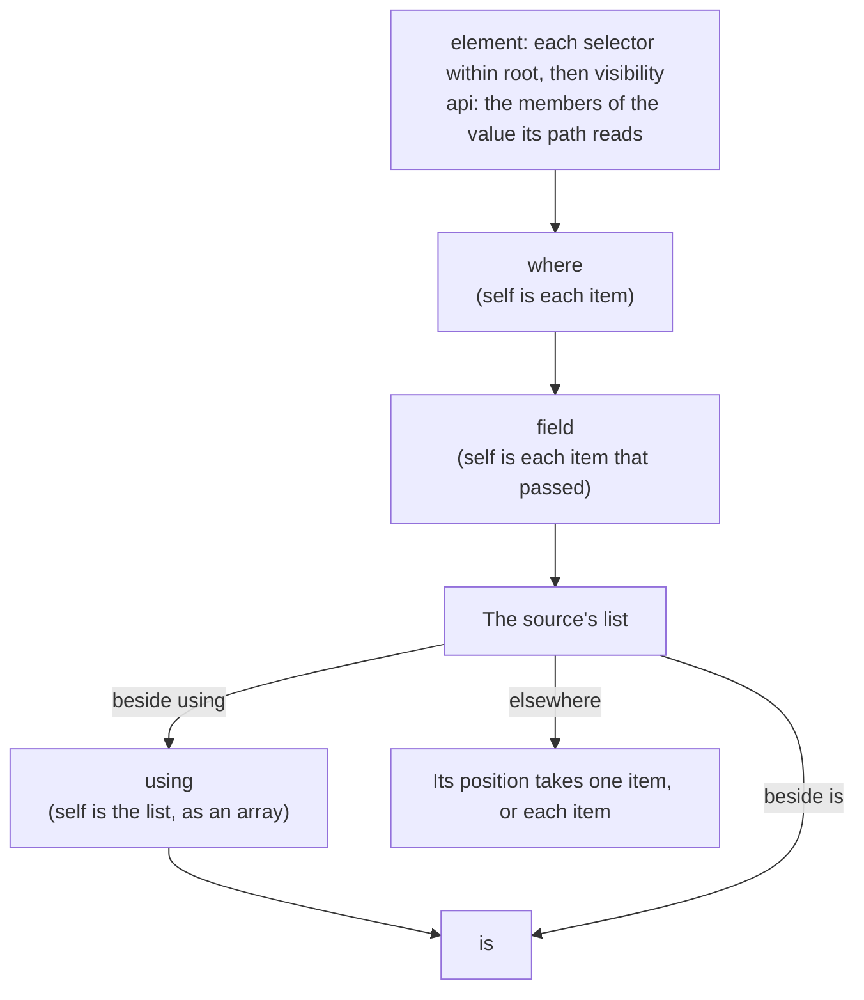

# Sources

A source reads the page. What each gives is in [Values](expressions.md#values).

| Source | Reads |
|---|---|
| [`element`](#element) | Elements matching a selector |
| [`text`](#text) | Matches of a text pattern |
| [`api`](#api) | A Web API, by path: a property or a method's result |

## Lists: `where` and `field`

`element` and `api` take two keys over the items of a list:

| Key | Meaning |
|---|---|
| `where` | A [predicate](predicates.md) each item must pass, or an expression over the item ([`self`](expressions.md#self)). On `element`, tested on the elements that pass `visibility` |
| `field` | The value read from each item that passes, in one of the forms below. On an `api` value that is not a list, the value read from it |

A source's items reach the expression around it in this order. `text` takes neither key and gives its matches:



The last step is in [Selected lists](expressions.md#selected-lists).

`where` applies before `field`, so one property can select the items and another give their values. The total duration of the videos with metadata loaded:

```json
{"sum": {"element": {"selector": "video", "where": {"readyState": {"gte": 1}}, "field": "duration"}}}
```

`field` reads from the item as an `api` `path` reads from the global object. It is an object of `path` and optional `args`, a string, short for `{"path": <string>}`, or an expression. [`self`](expressions.md#self) in `args` or in the expression is the item:

| Key | Applies |
|---|---|
| `path` | Names joined by `.`, read in turn from the item |
| `args` | An array of [arguments](#arguments). The last name in `path` is then a method, called with them |

```json
"field": "naturalWidth"
"field": "currentSrc.length"
"field": "options.length"
"field": {"path": "getAttribute", "args": ["role"]}
"field": {"api": {"path": "Number.isFinite", "args": [{"self": "duration"}]}}
"field": {"api": {"path": "Math.min", "args": [{"self": "naturalWidth"}, 2000]}}
```

The last is each image's natural width, capped at 2000.

Names are read and methods called as [Property reads](predicates.md#property-reads) describes. A `field` value has the type of what it read, and the position it reaches checks it: in number position, a value that is not a number fails ([Positions](expressions.md#positions)). `where: {"<property>": {"type": "number"}}` excludes those items.

A method called on `element` items is one that leaves the page unchanged, from the [element allowlist](validation.md#element-allowlist). A method called on `api` items is on the [`api` allowlist](#allowed-names).

## `element`

Takes the keys of the `element` condition, `where` and `field` ([Lists](#lists-where-and-field)), and [`root`](#root).

```json
{"element": {"selector": "img", "where": {"complete": true, "naturalWidth": {"gt": 0}}, "root": ["#comments"]}}
{"api": {"path": "Math.min.apply", "args": [null, {"element": {"selector": "img", "field": "naturalWidth"}}]}}
{"element": {"selector": "input[name='q']", "field": "value.length"}, "is": {"gt": 0}}
{"only": {"element": {"selector": "#comments"}}, "is": {"hidden": false}}
```

The list is the distinct elements matching any selector and passing `visibility`, then `where`, or with `field`, each one's value. `where` reads no property of an element `visibility` excludes.

## `text`

Takes the keys of the [`text` condition](conditions.md#text), and [`root`](#root).

```json
{"text": {"xpath": "...", "pattern": ["page not found"]}, "using": "length"}
```

The list is the non-overlapping matches of the combined pattern, case-insensitive, in each source: each `selector` element's `textContent`, and each `xpath` expression's joined text. Each match's value is the matched string.

Overlapping sources count their shared text once per source: `body` together with a `div` inside it counts the `div`'s matches twice.

### XPath

An `xpath` expression selects nodes, and the text of the nodes one expression selects is joined without a separator and matched as a whole. A pattern matches across inline element boundaries: `adblocker <b>detected</b>` matches `adblocker detected`.

An expression starting `//` selects from the whole document, whatever its context node. One starting `.//` selects within each [`root`](#root).

| Limitation | Consequence |
|---|---|
| XPath is structural | A pattern inside a `display: none` subtree still matches. Visibility is only expressible through an [`element`](conditions.md#element) condition |
| XPath 1.0 only | `matches()` and `lower-case()` raise `SyntaxError`; only `translate()` is available. XPath expressions select nodes; pattern matching stays in the regex |
| Namespace-aware in XHTML | In a document served as `application/xhtml+xml`, an element name in an expression matches no element, so `//body//text()` selects nothing. `local-name()` matches by name ([Rendered text](recipes.md#rendered-text)) |
| Shadow DOM is unreachable | `//text()` does not cross shadow roots, and neither does `selector` |
| Layout-free, but costlier than `textContent` | Under the `auto` trigger the XPath expression re-runs on each interval, so scope it to a container where the detector allows it |

Each pattern is tested against the selected text in bounded chunks rather than the whole text joined. `xpathConfig` sizes the chunks: `chunkSize` (default 8192) the characters matched at a time, and `chunkTail` (default `chunkSize / 16`) the characters carried between chunks, which bounds the longest match that can span a chunk boundary. `chunkSize: 0` disables chunking. Omit both unless a detector needs tuning. `xpathConfig` does not affect `selector`.

An XPath expression can restrict a search to rendered text, excluding `script`, `style` and the like: [Rendered text](recipes.md#rendered-text).

## `root`

`root` is where `element` and `text` read: an expression, or an array of them. Each gives a selector, a node or a list of nodes, and a selector string, read or literal, selects from the document. The scope is the union of their nodes, with a node inside another dropped. Without `root`, the scope is the document, and `"root": []` is an empty scope. An `api` reads from another value through [`using`](expressions.md#using).

A selector `root` `R` is short for `{"element": {"selector": R}}`.

Within each root, `selector`s are queried from the root and `xpath` expressions are evaluated with the root as context node, so a scoped XPath expression starts `.//` ([XPath](#xpath)). A `text` with `root` and neither `selector` nor `xpath` reads each root's `textContent`.

A root read through `using` reaches an open shadow root. Here the images in the shadow root of the page's one `my-widget`:

```json
{"element": {"selector": "img", "root": {"only": {"element": {"selector": "my-widget"}}, "using": "shadowRoot"}}}
```

A root that selects nothing, or reads `null` or `undefined`, is an empty scope: `element` and `text` select no items. A guard tells an absent region from an empty one. The guard holds when the region is present, and sits as an operand of the top-level `all` of the condition or `define` value reading the scoped expressions, or in the condition of an `if` around them:

| Where | Guard and `root` |
|---|---|
| `actions` | The root is bound with `define`. The guard and `root` are `ref`s to it |
| `match` | The guard is the root's expression, and `root` repeats it |

In an array `root`, each entry has its own guard.

```json
"match": {"all": [
  {"element": {"selector": "#comments"}},
  {"element": {"selector": "img", "root": {"element": {"selector": "#comments"}}}, "using": "length", "is": {"lt": 1}}
]}
```

```json
"actions": [
  {"define": {"comments": {"element": {"selector": "#comments"}}}},
  {"if": {"all": [
     {"ref": "comments"},
     {"element": {"selector": "img", "root": {"ref": "comments"}}, "using": "length", "is": {"lt": 1}}
   ]},
   "then": {"fireEvent": {"type": "emptyComments"}}}
]
```

In boolean position an `element` or `text` guard holds when it selects an item. A guard on a root that is not an `element` or `text` source has `is`, such as `{"ref": "widget", "is": {"type": "object"}}`.

A scoped expression needs a guard unless it is read only in boolean position with no `none` above it, or its root is `{"self": {}}`, the item a `where` or `field` binds ([`root` guards](validation.md#root-guards)).

## `api`

Reads a Web API by path, from the global object, and gives the value it reads. It takes a body, or a path, short for `{"path": <path>}`. [`self`](expressions.md#self) takes the same body and reads from a bound value, such as the expression beside [`using`](expressions.md#using).

```json
{"api": "document.readyState", "is": "complete"}
{"api": "document.hidden"}
{"api": {"path": "document.fonts", "where": {"status": "error"}}, "using": "length"}
{"api": "document.title.length"}
{"api": {"path": "Array.from", "args": [{"api": {"path": "document.title.matchAll", "args": ["\\S+"]}}]}, "using": "length"}
{"api": {"path": "matchMedia", "args": ["(prefers-reduced-motion: reduce)"], "field": "matches"}, "is": true}
```

| Key | Meaning |
|---|---|
| `path` | Property names joined by `.`, read in turn from the global object, or under `self`, from the bound value. A `self` body without `path` reads the bound value itself |
| `args` | Optional. An array of [arguments](#arguments). The last name in `path` is then a method, called with them; `[]` calls it with none |
| `where` | Optional, on a list. A predicate or an expression each item must pass ([Lists](#lists-where-and-field)) |
| `field` | Optional. The value read from each item that passes `where`, or from a value that is not a list ([Lists](#lists-where-and-field)) |

Each name is read as [Property reads](predicates.md#property-reads) describes, through the getters and methods C-S-S captures when it parses the detectors.

| `path` reads | Gives |
|---|---|
| An iterable other than a string or a node: an array, `FontFaceSet`, `StyleSheetList`, `NodeList` | The value, which is also a list of its members in iteration order. With `where` or `field`, the list of the members that pass, or of their values |
| Any other value | The value. `field` reads from it |

| Edge | Behaviour |
|---|---|
| Maplike interfaces, such as `Headers` | Each item is a `[key, value]` array |
| A path reading an element, such as `document.activeElement` | The element is the value, with no `visibility` check. A node is never a list, an iterable `select` or `form` included |
| `where` on an item that is not an object | Tests it as any other item: a property path reads through its prototype, such as a string's `length`, and a read from `null` or `undefined` gives `undefined` |
| `where` on a value that is not a list | Fails |

### Arguments

`args`, on `api` and in `field`, is an array. Each entry is:

| Entry | Argument |
|---|---|
| A literal or an object | An expression in value position: `0`, `"navigation"`, `null`, `{"ref": "navigation"}`, `{"only": {"element": {"selector": "main"}}}`, `{"self": "startTime"}` |
| `{"expr": [...]}` | A JS array of its entries' values ([`expr`](expressions.md#expr)) |

A selected list gives the list as an array, as it does beside `using` ([Selected lists](expressions.md#selected-lists)). The expression beside `using` is evaluated first, then `args` in order, then the call.

A method converts its arguments as JS does: `Math.max` reads `"5"` as 5, `null` as 0 and an object through its `valueOf`. `type` in `where` guards the items of a list ([Failure and type](predicates.md#failure-and-type)).

JS builtins give the values JSON does not write directly ([JS builtins](recipes.md#js-builtins)). The widest image's natural width:

```json
{"api": {"path": "Math.max.apply", "args": [null, {"element": {"selector": "img", "field": "naturalWidth"}}]}}
```

| Case | Behaviour |
|---|---|
| `apply` over `null`, `undefined` or an iterable with no `length` | No arguments: `Math.max.apply` gives `-Infinity` |
| A call with more arguments than the engine passes | Fails ([Failures](failures.md)). The limit differs by engine, and a list of a page's elements can exceed it. The `resource` timeline holds 250 entries by default |
| `Array.from`, `Object.fromEntries` | Use the iterator as the page leaves it ([Page code](predicates.md#page-code)) |

### Allowed names

An `api` reads only names on the allowlist in this repository's CI, and a detector reading a name not on the list adds it in the same change. A name is the path read from the global object, such as `performance.getEntriesByType`, and a name read from its value adds to it: `performance.getEntriesByType.duration`. The naming rules are in [Allowed names](validation.md#allowed-names).

### Performance timeline

The timeline is read synchronously, as it stands at evaluation. Load time, paint times and resource counts are in [Performance timeline](recipes.md#performance-timeline).

```json
{"api": {"path": "performance.getEntriesByType", "args": ["navigation"], "field": "loadEventEnd"}, "is": {"gte": 8000}}
```

| Call | Gives |
|---|---|
| `getEntriesByType(type)` | Entries of that type |
| `getEntriesByName(name)`, `getEntriesByName(name, type)` | Entries with that name, and of that type |
| `getEntries()` | Every entry |

`getEntriesByType` returns an array, which is a value, so `only` takes one entry from it ([Several fields of the `navigation` entry](recipes.md#several-fields-of-the-navigation-entry)).

A field the engine does not define on the entry, such as `responseStatus` on an engine without it, reads `undefined`, in `where`, in `field` and in a `self` path. A comparison on `undefined` is `false` ([Missing fields and throwing reads](recipes.md#missing-fields-and-throwing-reads)). A `Reflect.has` call tells a field the engine lacks from one holding `undefined` ([Presence](predicates.md#presence)).

`loadEventEnd` is 0 until the load event fires, and 0 is a value. `"is": 0` at a late offset reads a load that never finished.

Entry types that the engine delivers only to a `PerformanceObserver` are not in the timeline. The list is empty, and reading one value from it fails ([Values that do not fit](failures.md#values-that-do-not-fit)).

The page sets the names of `mark` and `measure` entries, so `getEntriesByName` without a type also returns a mark the page created with that name. Read for one value, two entries then remain, which fails, and in the list's `length` or under `Math.max.apply` the mark is one of the items. The type argument excludes them.

Reading `resource` entries by name puts a URL in config. Only the value read is sent.
