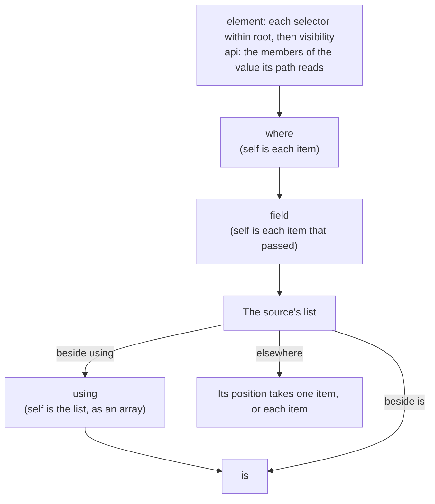

# Sources

A source reads the page. See [Values](expressions.md#values) for what each one gives.

| Source | Reads |
|---|---|
| [`element`](#element) | Elements matching a selector |
| [`text`](#text) | Matches of a text pattern |
| [`api`](#api) | A Web API, by path: a property or a method's result |
| [`observed`](#observed) | The performance entries or events of one type recorded in the frame, over a recent window |
| [`trigger`](#trigger) | The arrival that started the run |

## Lists: `where` and `field`

`element`, `api`, `observed` and `trigger` take two keys that work on the items of a list:

| Key | Meaning |
|---|---|
| `where` | A [predicate](predicates.md) each item must pass, or an expression over the item ([`self`](expressions.md#self)). On `element`, it's only tested on the elements that pass `visibility` |
| `field` | The value read from each item that passes, in one of the forms below. On an `api` value that isn't a list, the value read from it |

A source's items go through these steps before they reach the expression around it. `text` takes neither key, and gives its matches:



See [Selected lists](expressions.md#selected-lists) for the last step.

`where` applies before `field`, so one property can select the items and another can give their values. Here's the total duration of the videos with metadata loaded:

```json
{"sum": {"element": {"selector": "video", "where": {"readyState": {"gte": 1}}, "field": "duration"}}}
```

`field` reads from the item the same way an `api` `path` reads from the global object. It's either an object with `path` and optional `args`, a string (short for `{"path": <string>}`), or an expression. [`self`](expressions.md#self) in `args` or in the expression is the item:

| Key | Applies |
|---|---|
| `path` | Names joined by `.`, read in turn from the item |
| `args` | An array of [arguments](#arguments). The last name in `path` is then a method, called with them |

```json
"field": "naturalWidth"
"field": "currentSrc.length"
"field": "options.length"
"field": {"path": "getAttribute", "args": ["role"]}
"field": {"api": {"path": "Number.isFinite", "args": [{"self": "duration"}]}}
"field": {"api": {"path": "Math.min", "args": [{"self": "naturalWidth"}, 2000]}}
```

The last is each image's natural width, capped at 2000.

Names are read and methods are called as described in [Property reads](predicates.md#property-reads). A `field` value has the type of whatever it read, and that type is checked where the value is used: in number position, a value that isn't a number fails ([Positions](expressions.md#positions)). `where: {"<property>": {"type": "number"}}` excludes those items.

A method called on `element` items must be on the [element allowlist](validation.md#element-allowlist), whose methods leave the page unchanged. A method called on `api` items must be on the [`api` allowlist](#allowed-names).

## `element`

It takes the keys of the `element` condition, plus `where` and `field` ([Lists](#lists-where-and-field)) and [`root`](#root).

```json
{"element": {"selector": "img", "where": {"complete": true, "naturalWidth": {"gt": 0}}, "root": ["#comments"]}}
{"api": {"path": "Math.min.apply", "args": [null, {"element": {"selector": "img", "field": "naturalWidth"}}]}}
{"element": {"selector": "input[name='q']", "field": "value.length"}, "is": {"gt": 0}}
{"only": {"element": {"selector": "#comments"}}, "is": {"hidden": false}}
```

The list is the distinct elements that match any selector and pass `visibility`, then `where` (or with `field`, each one's value). `where` doesn't read any property of an element that `visibility` excludes.

## `text`

It takes the keys of the [`text` condition](conditions.md#text), plus [`root`](#root).

```json
{"text": {"xpath": "...", "pattern": ["page not found"]}, "using": "length"}
```

The list is the non-overlapping matches of the combined pattern, case-insensitive, in each source: each `selector` element's `textContent`, and each `xpath` expression's joined text. Each match's value is the matched string.

Overlapping sources count their shared text once per source: `body` together with a `div` inside it counts the `div`'s matches twice.

### XPath

An `xpath` expression selects nodes, and the text of those nodes is joined without a separator and matched as a whole. This means a pattern matches across inline element boundaries: `adblocker <b>detected</b>` matches `adblocker detected`.

An expression starting `//` selects from the whole document, whatever its context node. One starting `.//` selects within each [`root`](#root).

| Limitation | Consequence |
|---|---|
| XPath is structural | A pattern inside a `display: none` subtree still matches. Visibility can only be checked with an [`element`](conditions.md#element) condition |
| XPath 1.0 only | `matches()` and `lower-case()` raise `SyntaxError`, and only `translate()` is available. Use XPath to select nodes, and leave pattern matching to the regex |
| Namespace-aware in XHTML | In a document served as `application/xhtml+xml`, an element name in an expression matches no element, so `//body//text()` selects nothing. `local-name()` matches by name ([Rendered text](recipes.md#rendered-text)) |
| Shadow DOM is unreachable | `//text()` does not cross shadow roots, and neither does `selector` |
| Layout-free, but costlier than `textContent` | With the `auto` trigger, the XPath expression re-runs at each interval unless the page is unchanged and [`readCacheMaxAgeMs`](overview.md#feature-settings) keeps the last read, so scope it to a container where the detector can |

Each pattern is tested against the selected text in bounded chunks instead of all at once. `xpathConfig` sets the chunk sizes: `chunkSize` (default 8192) is the number of characters matched at a time, and `chunkTail` (default `chunkSize / 16`) is the number of characters carried over between chunks, which limits the longest match that can span a chunk boundary. `chunkSize: 0` turns chunking off. Leave both out unless a detector needs tuning. `xpathConfig` doesn't affect `selector`.

An XPath expression can restrict a search to rendered text, leaving out `script`, `style` and similar (see [Rendered text](recipes.md#rendered-text)).

## `root`

`root` sets where `element` and `text` read. It's an expression, or an array of them, and each one gives a selector, a node or a list of nodes. A selector string, whether read or literal, selects from the document. The scope is the union of their nodes, and a node inside another is dropped. Without `root`, the scope is the whole document, and `"root": []` is an empty scope. To make an `api` read from another value, use [`using`](expressions.md#using) instead.

A selector `root` `R` is short for `{"element": {"selector": R}}`.

Within each root, `selector`s are queried from the root and `xpath` expressions are evaluated with the root as the context node, so a scoped XPath expression starts `.//` ([XPath](#xpath)). A `text` with `root` and neither `selector` nor `xpath` reads each root's `textContent`.

Reading a root through `using` can reach an open shadow root. Here are the images in the shadow root of the page's one `my-widget`:

```json
{"element": {"selector": "img", "root": {"only": {"element": {"selector": "my-widget"}}, "using": "shadowRoot"}}}
```

A root that selects nothing, or reads `null` or `undefined`, is an empty scope, so `element` and `text` select nothing. Use a guard to tell an absent region apart from an empty one. The guard holds when the region is present, and goes either as an operand of the top-level `all` of the condition or `define` value that reads the scoped expressions, or in the condition of an `if` around them:

| Where | Guard and `root` |
|---|---|
| `actions` | The root is bound with `define`. The guard and `root` are `ref`s to it |
| `match` | The guard is the root's expression, and `root` repeats it |

In an array `root`, each entry needs its own guard.

```json
"match": {"all": [
  {"element": {"selector": "#comments"}},
  {"element": {"selector": "img", "root": {"element": {"selector": "#comments"}}}, "using": "length", "is": {"lt": 1}}
]}
```

```json
"actions": [
  {"define": {"comments": {"element": {"selector": "#comments"}}}},
  {"if": {"all": [
     {"ref": "comments"},
     {"element": {"selector": "img", "root": {"ref": "comments"}}, "using": "length", "is": {"lt": 1}}
   ]},
   "then": {"fireEvent": {"type": "emptyComments"}}}
]
```

In boolean position an `element` or `text` guard holds when it selects an item. A guard on a root that isn't an `element` or `text` source needs `is`, such as `{"ref": "widget", "is": {"type": "object"}}`.

A scoped expression needs a guard unless it's only read in boolean position with no `none` above it, or its root is `{"self": {}}` (the item a `where` or `field` binds) ([`root` guards](validation.md#root-guards)).

## `api`

`api` reads a Web API by path from the global object, and gives the value it reads. It takes a body, or a path as short for `{"path": <path>}`. [`self`](expressions.md#self) takes the same body but reads from a bound value, such as the expression beside [`using`](expressions.md#using).

```json
{"api": "document.readyState", "is": "complete"}
{"api": "document.hidden"}
{"api": {"path": "document.fonts", "where": {"status": "error"}}, "using": "length"}
{"api": "document.title.length"}
{"api": {"path": "Array.from", "args": [{"api": {"path": "document.title.matchAll", "args": ["\\S+"]}}]}, "using": "length"}
{"api": {"path": "matchMedia", "args": ["(prefers-reduced-motion: reduce)"], "field": "matches"}, "is": true}
```

| Key | Meaning |
|---|---|
| `path` | Property names joined by `.`, read in turn from the global object, or under `self`, from the bound value. A `self` body without `path` reads the bound value itself |
| `args` | Optional. An array of [arguments](#arguments). The last name in `path` is then a method, called with them; `[]` calls it with none |
| `where` | Optional, on a list. A predicate or an expression each item must pass ([Lists](#lists-where-and-field)) |
| `field` | Optional. The value read from each item that passes `where`, or from a value that is not a list ([Lists](#lists-where-and-field)) |

Each name is read as described in [Property reads](predicates.md#property-reads), through the getters and methods C-S-S captures when it parses the detectors.

| `path` reads | Gives |
|---|---|
| An iterable other than a string or a node: an array, `FontFaceSet`, `StyleSheetList`, `NodeList` | The value, which is also a list of its members in iteration order. With `where` or `field`, the list of the members that pass, or of their values |
| Any other value | The value. `field` reads from it |

| Edge | Behaviour |
|---|---|
| Maplike interfaces, such as `Headers` | Each item is a `[key, value]` array |
| A path reading an element, such as `document.activeElement` | The element is the value, with no `visibility` check. A node is never a list, even an iterable `select` or `form` |
| `where` on an item that isn't an object | Tests it like any other item: a property path reads through its prototype, such as a string's `length`, and a read from `null` or `undefined` gives `undefined` |
| `where` on a value that isn't a list | Fails |

### Arguments

`args`, on `api` and in `field`, is an array. Each entry is:

| Entry | Argument |
|---|---|
| A literal or an object | An expression in value position: `0`, `"navigation"`, `null`, `{"ref": "navigation"}`, `{"only": {"element": {"selector": "main"}}}`, `{"self": "startTime"}` |
| `{"expr": [...]}` | A JS array of its entries' values ([`expr`](expressions.md#expr)) |

A selected list is passed as an array, as it is beside `using` ([Selected lists](expressions.md#selected-lists)). The expression beside `using` is evaluated first, then `args` in order, then the call.

A method converts its arguments as JS does: `Math.max` reads `"5"` as 5, `null` as 0 and an object through its `valueOf`. `type` in `where` guards the items of a list ([Failure and type](predicates.md#failure-and-type)).

JS builtins give you values that JSON can't express directly ([JS builtins](recipes.md#js-builtins)). Here's the widest image's natural width:

```json
{"api": {"path": "Math.max.apply", "args": [null, {"element": {"selector": "img", "field": "naturalWidth"}}]}}
```

| Case | Behaviour |
|---|---|
| `apply` over `null`, `undefined` or an iterable with no `length` | No arguments: `Math.max.apply` gives `-Infinity` |
| A call with more arguments than the engine passes | Fails ([Failures](failures.md)). The limit differs by engine, and a list of a page's elements can exceed it. The `resource` timeline keeps up to 250 entries by default |
| `Array.from`, `Object.fromEntries` | Use the iterator as the page leaves it ([Page code](predicates.md#page-code)) |

### Allowed names

An `api` can only read names on the allowlist in this repository's CI, so a detector reading a new name needs to add it to the list in the same change. A name is the path read from the global object, such as `performance.getEntriesByType`, and a name read from its value extends it: `performance.getEntriesByType.duration`. See [Allowed names](validation.md#allowed-names) for the naming rules.

### Performance timeline

The timeline is read synchronously, as it is at the time of evaluation. See [Performance timeline](recipes.md#performance-timeline) for load time, paint times and resource counts.

```json
{"api": {"path": "performance.getEntriesByType", "args": ["navigation"], "field": "loadEventEnd"}, "is": {"gte": 8000}}
```

| Call | Gives |
|---|---|
| `getEntriesByType(type)` | Entries of that type |
| `getEntriesByName(name)`, `getEntriesByName(name, type)` | Entries with that name, and of that type |
| `getEntries()` | Every entry |

`getEntriesByType` returns an array, which is a value, so `only` takes one entry from it ([Several fields of the `navigation` entry](recipes.md#several-fields-of-the-navigation-entry)).

A field the engine doesn't define on the entry, such as `responseStatus` on an engine without it, reads `undefined` in `where`, in `field` and in a `self` path. A comparison on `undefined` is `false` ([Missing fields and throwing reads](recipes.md#missing-fields-and-throwing-reads)). A `Reflect.has` call tells apart a field the engine doesn't have and one set to `undefined` ([Presence](predicates.md#presence)).

`loadEventEnd` is 0 until the load event fires, and 0 is still a value, so `"is": 0` at a late offset means the load never finished.

Entry types that the engine only delivers to a `PerformanceObserver` aren't in the timeline, so the list is empty and reading one value from it fails ([Values that do not fit](failures.md#values-that-do-not-fit)). [`observed`](#observed) reads them instead.

The page sets the names of `mark` and `measure` entries, so `getEntriesByName` without a type also returns a mark the page created with that name. If you read one value, there are then two entries, which fails, and in the list's `length` or under `Math.max.apply`, the mark is counted as one of the items. Passing the type argument excludes them.

Reading `resource` entries by name puts a URL in config. Only the value read is sent.

## `observed`

`observed` reads the items recorded in the frame of one type: the performance entries of an entry type, or the events of an event type. Recording starts when the detectors are parsed, as the page loads, for each type a detector reads or observes.

```json
{"observed": {"entryType": "long-animation-frame", "where": {"blockingDuration": {"gte": 200}}, "field": "blockingDuration"}}
{"observed": {"event": "click", "keep": {"withinMs": 1000}}, "using": "length"}
{"observed": {"event": "scroll", "target": {"api": "visualViewport"}, "keep": {"count": 1}}, "using": {"path": "at", "args": [-1]}}
```

| Key | Meaning |
|---|---|
| `entryType` | A performance entry type. A body has one of `entryType` and `event` |
| `durationThreshold` | Optional, with `"entryType": "event"` only, and at least 16. The body gives the entries whose `duration` is at or over it. Absent, the engine's default of 104 ms applies |
| `event` | An event type |
| `target` | Optional, with `event`. What the listener is on, as `{"api": <path>}` ([Event targets](#event-targets)). Absent, it's `window` |
| `where` | Optional. A predicate or expression each item must pass ([Lists](#lists-where-and-field)) |
| `field` | Optional. The value read from each item that passes `where` |
| `keep` | The window of recorded items the body reads ([`keep`](#keep)) |

It gives a selected list of the items in its window that pass `where`, in the order they were recorded. A type with nothing recorded, or one the engine doesn't support, gives a list with no items. Without `field`, in boolean position, it holds when it has an item, as `element` does.

The entry types, event types and targets a body can name, and the fields each item has, are on allowlists in this repository's CI ([Recorded types](validation.md#recorded-types-and-observe)). `unload` and `beforeunload` are never on them, since listening for either takes the page out of the back/forward cache.

### Items

| Item | Is |
|---|---|
| Entry | The `PerformanceEntry` the observer delivered |
| Event | The `Event` the listener received, with `target` as it was during dispatch. Only events with `isTrusted` true are recorded |

`where`, `field` and `using` read an item's fields by path, as on `api` items. A path can have several names, such as `changedTouches.0.clientX` for a touch's position. `target` is an element, so names read from it are checked against the [element allowlist](validation.md#element-allowlist).

An event's `timeStamp` is when the user acted, so input that waited behind a busy main thread keeps its earlier time.

### Event targets

| `target` | The listener receives |
|---|---|
| `window`, the default | Events dispatched at `window` or through the DOM tree. It listens in the capture phase, so it also receives events that don't bubble, such as element scrolls and `invalid` |
| `document` | Events dispatched at `document` or through the DOM tree below it |
| `visualViewport` | Events dispatched at `visualViewport`, such as its `scroll` |
| `navigation` | `navigate` and `navigatesuccess`, which are dispatched only there |

A `target` is read once, when recording starts, so it's an `api` path on the target allowlist. To read the events on one element, test `target` in `where`, which also covers elements added later and elements the page re-renders.

### `keep`

Each `observed` body reads a window of the items recorded of its type:

| `keep` | The body reads |
|---|---|
| `{"count": K}` | The last `K` items |
| `{"withinMs": N}` | The items recorded in the last `N` ms |
| `{"count": K, "withinMs": N}` | The items recorded in the last `N` ms, at most the last `K` |
| `null` | Every item recorded. CI allows it on `visibilitychange` and `pagehide` only |
| Absent | `{"count": 10, "withinMs": 5000}`, which the config build writes onto the body |

```json
{"observed": {"event": "touchstart", "keep": {"count": 4}}}
{"observed": {"event": "scroll", "keep": {"withinMs": 2000, "count": 100}}}
```

| Rule | Detail |
|---|---|
| Age | From when the item was recorded. An item's `timeStamp` or `startTime` can be earlier, so clicks dispatched together after a long task all count as recent, and a body that needs items by input time tests `timeStamp` in `where` |
| Anchor | `withinMs` runs back from when the `observed` is evaluated, so in a run with `delayMs` the window includes the delay |
| Per body | Each body reads its own window, whatever other detectors read of the same type |
| Caps | CI caps `count` and `withinMs` per type ([Recorded types](validation.md#recorded-types-and-observe)) |

## `trigger`

`trigger` reads the arrival that started the run: the entries or event that ran the detector through its [`observe`](overview.md#observe) trigger, or the `auto` timer or breakage report.

```json
{"trigger": {"event": "click"}, "using": {"path": "at", "args": [0]}}
{"trigger": {"entryType": "long-animation-frame", "field": "blockingDuration"}, "using": {"api": {"path": "Math.max.apply", "args": [null, {"self": {}}]}}}
{"none": [{"trigger": {"breakageReport": {}}}]}
```

| Key | Meaning |
|---|---|
| `entryType`, `durationThreshold`, `event`, `target`, `where`, `field` | As on [`observed`](#observed). The type and target are those of a body in the detector's `observe` trigger |
| `auto` | `{}`. Gives an item when an `auto` timer started the run |
| `breakageReport` | `{}`. Gives an item when a breakage report started the run |

A body has exactly one of `entryType`, `event`, `auto` and `breakageReport`, and no `keep`. It gives a selected list of the arrival's items:

| Started by | Items |
|---|---|
| An entry type | The entries the observer delivered together, which can be several after a long task |
| An event | The event |
| An `auto` timer, a breakage report | One item, whose `timeStamp` is when the run started |

A body naming another type gives a list with no items, so in boolean position `{"trigger": {"event": "click"}}` holds only in a run a click started. A run with `delayMs` keeps its arrival's items until it runs. CI rejects `trigger` in `match`, which reads the page only.
